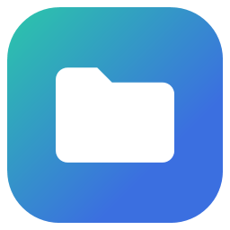
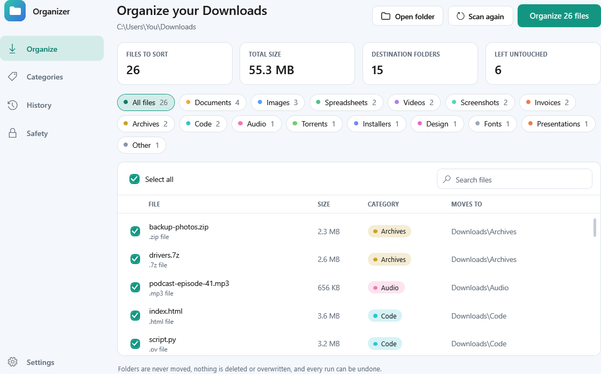
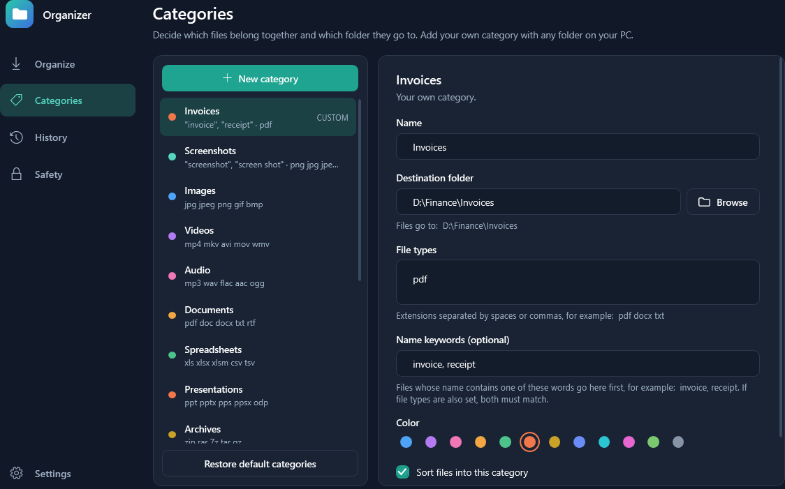
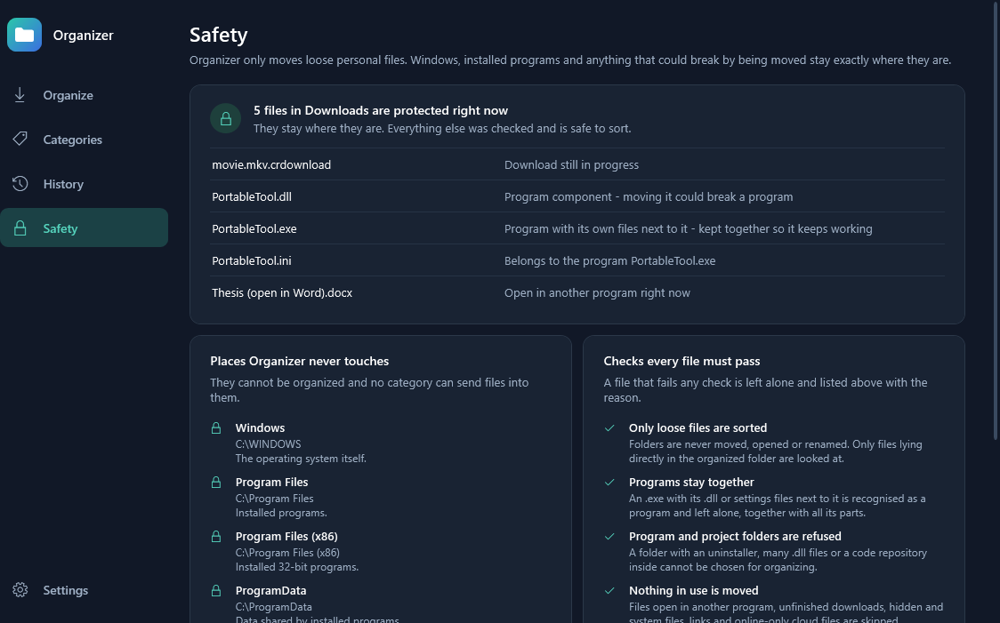
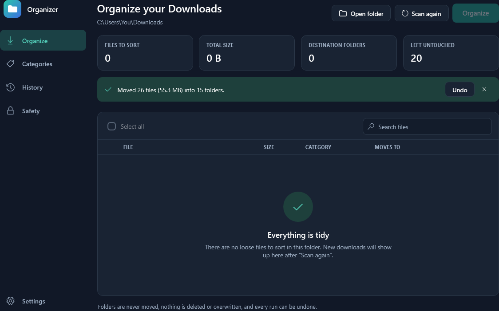
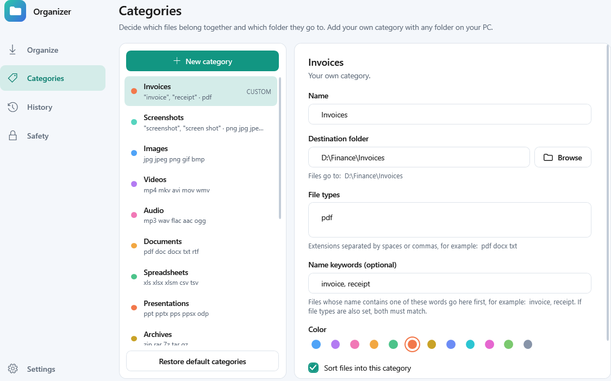

<div align="center">



# Organizer

### A tidy Downloads folder in one click. Back to how it was in one more.

Organizer sorts the loose files in your Downloads folder into clean folders by type.<br>
You see where every file will go before anything moves — and every run can be undone.

<a href="https://github.com/LeerBox/Organizer/releases"></a>

[](https://github.com/LeerBox/Organizer/releases)
[](LICENSE)


**Free · Open source · Portable · No ads · No telemetry · Works offline**

<picture>
  <source media="(prefers-color-scheme: dark)" srcset="docs/images/home-dark.png">
  
</picture>

</div>

## Why people pick Organizer

<table>
<tr><td nowrap>👀&nbsp;<strong>Preview&nbsp;first</strong></td><td>Every file is listed with its category and the folder it will move to. Untick anything you want to keep where it is. Nothing moves until you click Organize.</td></tr>
<tr><td nowrap>↩️&nbsp;<strong>One-click&nbsp;undo</strong></td><td>Every run is saved to History. Undo puts each file back exactly where it was and removes the folders the run created.</td></tr>
<tr><td nowrap>🧠&nbsp;<strong>Smarter&nbsp;than&nbsp;extensions</strong></td><td>Name keywords separate screenshots from photos and invoices from other PDFs. Files with a missing or unknown extension are identified from their content.</td></tr>
<tr><td nowrap>📁&nbsp;<strong>Your&nbsp;own&nbsp;folders</strong></td><td>Add a category with any folder on your PC — for example send everything named “invoice” straight to <code>D:\Finance\Invoices</code>.</td></tr>
<tr><td nowrap>🛡️&nbsp;<strong>Knows&nbsp;what&nbsp;to&nbsp;leave&nbsp;alone</strong></td><td>Program files, files that are open, unfinished downloads and system folders are recognised and never moved. Each one is listed with the reason.</td></tr>
<tr><td nowrap>📦&nbsp;<strong>Nothing&nbsp;to&nbsp;install</strong></td><td>Extract the zip and run it. No installer, no account, no background service, no network calls.</td></tr>
</table>

## Get started in a minute

1. **[Download Organizer-Portable.zip](https://github.com/LeerBox/Organizer/releases)** from the latest release.
2. **Extract** the whole archive to a folder you control.
3. **Double-click `Organizer.cmd`.** It scans your Downloads folder and shows the plan — nothing has moved yet.
4. **Review** the list, then click **Organize**.

**Requirements:** Windows 10 or 11 with Windows PowerShell 5.1 (included with Windows).

> [!NOTE]
> Organizer is an **unsigned public preview** without an independent security audit, so Windows may ask for confirmation the first time you run it. It moves files but never deletes or overwrites them, and every run can be undone from the History page.

## Take a look

| Your own categories and folders | Built-in safety rules |
| :---: | :---: |
|  |  |
| **Done — with Undo right there** | **Light theme** |
|  |  |

Light, dark and match-Windows themes are included.

## How files are sorted

Organizer decides in this order, and tells you the reason next to every file:

1. **Name keywords.** A category with keywords wins first. *Screenshot 2026-11-10.png* goes to Screenshots, not Images.
2. **File type.** The extension decides: `.mp4` to Videos, `.xlsx` to Spreadsheets, and so on.
3. **Content.** If the extension is missing or unknown, the first bytes of the file reveal what it is (PDF, PNG, JPG, ZIP, MP4 and more).
4. **Other.** Anything left goes to Other — or stays put if you switch that category off.

| Category | Examples |
| --- | --- |
| **Screenshots** | Images whose name contains *screenshot*, *snip*, *capture* |
| **Images** | jpg · png · gif · webp · svg · heic |
| **Videos** | mp4 · mkv · avi · mov · webm |
| **Audio** | mp3 · wav · flac · m4a · ogg |
| **Documents** | pdf · docx · txt · rtf · epub |
| **Spreadsheets** | xlsx · csv · ods |
| **Presentations** | pptx · odp · key |
| **Archives** | zip · rar · 7z · tar · iso |
| **Installers** | exe · msi · msix · apk |
| **Code** | py · js · html · json · ps1 · sql |
| **Design** | psd · ai · fig · blend · stl |
| **Fonts** · **Torrents** | ttf · otf · woff · torrent |

Every category can be renamed, recoloured, pointed at another folder, given more file types or keywords, or switched off. Optional date folders add `2026\2026-11` under each category.

## Safety

Organizer is built to be boring in the best way: it only moves loose personal files.

- **Protected places.** Windows, Program Files, ProgramData, AppData, drive roots, the Recycle Bin and other user accounts can neither be organized nor used as a destination. This is checked when you save a category and again at the moment of moving.
- **Program and project folders are refused.** A folder containing an uninstaller, many `.dll` files or a code repository cannot be chosen for organizing.
- **Programs stay together.** A loose `.exe` with its `.dll` or settings files beside it is recognised as a program and left alone with all its parts.
- **Nothing in use is moved.** Files open in another program, unfinished downloads, hidden and system files, links and online-only cloud files are skipped.
- **Nothing is deleted or overwritten.** A name clash gets ` (2)`. Free space is checked before moving to another drive. Folders are never moved.

Please keep these in mind:

- **Shortcuts and apps may still point at the old place.** If another program remembers the path of a file in Downloads, it will not find it after the move. Undo restores it.
- **Undo needs the files to still be there.** If you rename or delete a moved file afterwards, Undo cannot bring that one back.
- **The guards reduce risk, they do not eliminate it.** Look at the preview before you click Organize.

Full details are in [Safety and limitations](docs/SAFETY.md).

## FAQ

**Does it organize folders too?**
No. Only files lying directly in the chosen folder are sorted. Folders inside it are never moved, opened or renamed.

**Can I use it on a folder other than Downloads?**
Yes — pick it in Settings. Desktop or a messy documents folder work well. System, program and project folders are refused.

**Does it run in the background?**
No. Organizer only works while its window is open and only when you click Organize.

**Why does Windows warn me when I run it?**
The preview release is not code-signed, so Windows has no reputation data for it. Everything that runs is the readable PowerShell source in this repository.

**Where are my settings?**
In `%LOCALAPPDATA%\Organizer` on your PC. Nothing is sent anywhere.

## For developers

<details>
<summary><strong>Project layout</strong></summary>

| File | Purpose |
| --- | --- |
| `Organizer.cmd` | Launcher. Starts the app without leaving a console window open. |
| `Organizer.ps1` | The WPF user interface. |
| `OrganizerEngine.psm1` | Sorting rules, safety guards, moving, history and undo. No UI code. |
| `Tests/Test-OrganizerEngine.ps1` | Engine tests. |

</details>

<details>
<summary><strong>Run the tests</strong></summary>

```powershell
powershell.exe -NoProfile -ExecutionPolicy Bypass -File .\Tests\Test-OrganizerEngine.ps1
```

The suite works inside a disposable folder next to the test script and covers classification, custom folders, name clashes, locked files, program-file guards, protected destinations and undo. It never touches your real Downloads folder. Passing these checks does not establish correct behaviour on every Windows configuration.

</details>

## Feedback and contributing

Found a bug or have an idea? [Open an issue](https://github.com/LeerBox/Organizer/issues) with your Windows version, and remove personal paths from screenshots. New default categories, translations and accessibility improvements are welcome. See [CONTRIBUTING.md](CONTRIBUTING.md) before sending a pull request.

If Organizer is useful to you, a ⭐ helps other people find it.

## License

Released under the [MIT License](LICENSE).
